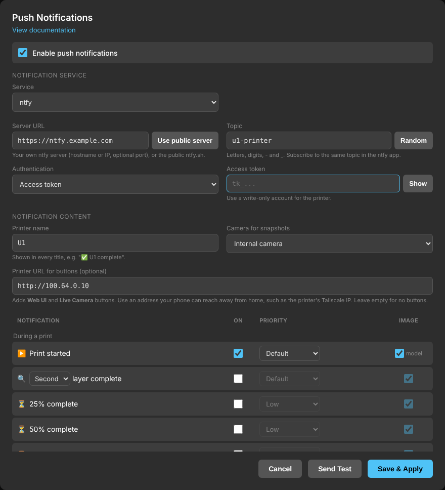

# Push Notifications

Print, progress and error notifications with camera snapshots, sent to your
phone through [ntfy](https://ntfy.sh) (the public `ntfy.sh` server or your own),
[Gotify](https://gotify.net) (text only), [Pushover](https://pushover.net), [Telegram](https://telegram.org),
[Discord](https://discord.com), and/or by email (Gmail, Brevo or any SMTP
server), and/or to a webhook for home automation.



**Contents:** [What it provides](#what-it-provides) ·
[Choosing a service](#choosing-a-service) ([Gotify](#gotify),
[Telegram](#telegram), [Webhook](#webhook), [Discord](#discord),
[Email](#email)) · [Requirements](#requirements) · [Setup](#setup) ·
[Self-hosting a push server](#self-hosting-a-push-server) · [Notifications from macros](#notifications-from-macros-and-g-code)
([ntfy](#ntfy-server), [Gotify](#gotify-server)) · [Security](#security) ·
[Configuration file](#configuration-file) · [Troubleshooting](#troubleshooting)

## What It Provides

| Notification | Image | Notes |
|---|---|---|
| ▶️ Print started | Model preview | The slicer thumbnail, and the slicer's estimated print time and ETA. With Moonraker's job queue in use: "Print 1/N remaining in queue", counting this one, and their total time. When the file has pauses in it (Orca's *add pause* and *change filament*, or a `PAUSE`, `M601`, `M226`, `M0`, `M1` or `M600` typed in): "⏸️ Print job contains 3 pauses (layers 12, 40 and 55)." With pre-print calibrations chosen when the print job started (Snapmaker U1: bed levelling, extrusion flow calibration): "📐 Pre-print calibrations selected: ..." |
| 📐 Pre-print calibrations finished | Model preview | When the chosen pre-print calibrations are done, before the park, heat-up and priming line. Only on printers that have them |
| ⏸️ Print paused / ▶️ Print resumed | Camera | Resumed includes time left and ETA. A pause the file itself asks for comes as "👋 … paused by the print job" instead, with its number, layer and any message the slicer put with it ("Pause 2 of 3 at layer 40, as planned in the print job. \"Insert magnet now\"") — the file wants something from you, like a normal pause doesn't, so its template sets the highest priority (`event.planned`; see [Priority](#priority)). Told apart by where in the file the print job stopped |
| 🎬 First layer started | Camera | Off by default. When the first layer begins, after the start routine (homing, bed mesh, flow calibration can take a while): time to watch it go down. With time left and ETA |
| 🔍 1st / 2nd / 3rd layer complete | Camera | Choose after which layer (default: 2nd). With time left and ETA. When printing by object (Orca's *print sequence: by object*), once per object, counted from the object's own first layer, or once per print job |
| ⏳ Progress | Camera | Off by default. At 25, 50 and/or 75 % (checkboxes under the row), the same percentage as Fluidd and the Snapmaker app, with time left and ETA |
| ⏱️ Status report | Camera | Off by default. Every N minutes of print time (5 to 720, default 30; a pause stops the clock), the first one an interval after the start: progress, layer ("42% complete, layer 120 of 285."), time left and ETA, with the picture |
| ✅ Print complete | Camera | Includes print time, and the prints still in the job queue with their total time. When printing by object: once per object as each one finishes and the next begins ("📦 object complete", with which object, e.g. "Object 2 of 3: Assembly", and time left; the last object's is the Print complete notification itself; `event.object` in the template), or once per print job |
| 🚫 Print cancelled | Camera | |
| 📐 Manual calibrations | Camera | Calibrations started from the touchscreen (bed levelling, XYZ offset, flow, input shaper): "📐 … Bed levelling complete" when one finishes (or hands over to the next queued one), "📐 … failed" when the printer drops into its abnormal state instead, and "👋 … user intervention needed" when one reaches a step that waits for you (brush the nozzle of Toolhead N; the screen waiting for a tap: nothing running in Klipper for more than 15 s). Not for the bed mesh inside a print job's start routine |
| 📣 From macros and G-code | Camera | Sent by any macro or G-code line: `RESPOND PREFIX=notify MSG="<title> \|\| <message> \|\| <priority>"` (see [Notifications from macros](#notifications-from-macros-and-g-code)) |
| 🧵 Filament loaded / unloaded | Spool | Off by default. When filament is loaded into or unloaded from a toolhead (the printer's own detection), with the toolhead and the filament, drawn as a spool in its colour (a multi-colour filament as wedges, one per colour); with Spoolman, the spool's name and how much is left. Loaded and unloaded can be ticked separately. Not during a print job: runouts and refills have their own notifications |
| 🌡️ Waiting for chamber temperature | Camera | When a print job, before its first layer, has been waiting for a target chamber temperature for 30 s (a wait that ends sooner, e.g. the printer asking for 45 °C in keep-warm mode and giving up at once, sends nothing): from any chamber heater (DragonBreath, Panda Breath, any `heater_generic`, set by `M141`/`M191`) or Snapmaker's own chamber wait (`WAIT_CHAMBER_TEMP`, which only waits with Snapmaker's purifier connected). Nothing is sent when there is no target, e.g. bed-only heating with no purifier: nothing waits then |
| 🌡️ Reached chamber temperature | Camera | When the chamber reaches the target, or is within 5 °C of it when the first layer starts (`M191` releases a few degrees short) |
| ⚠️ Chamber faults | Camera | **Timed out**: the first layer started (or Snapmaker's wait gave up) with the chamber more than 5 °C below target; the print job carries on below target. **Not heating**: no rise of 1 °C in 10 minutes while waiting. **DragonBreath**: a heater fault (with DragonBreath's own fault text) or the heater not responding, during the print job. Each says what happens next (printer still waiting, or print job continuing). A heater that stops heating altogether eventually trips Klipper's heater check: that's the 🛑 Klipper shutdown notification |
| ⚠️ Error | Camera | Faults that pause or stop a print, e.g. filament runout or a dirty bed |
| ⚠️ Warning | Camera | Faults that don't stop a print, e.g. a toolhead contact warning |
| 🛑 Klipper shutdown | Camera | Heater, thermistor and MCU faults, emergency stop |
| ⚡ Power loss recovery | Camera | Sent after boot when an interrupted print can be resumed, with a photo of the part (the camera gets up to 45 seconds to start) |
| 🌡️ Driver running hot | Camera | When the X or Y stepper driver reaches the set temperature (default 105 °C; the TMC2240 reports its own temperature, and warns itself at 120 °C). Once per print job, and again after a pause, so a print job paused for the heat and resumed can warn a second time, while a driver hovering at the limit doesn't send one after another. Shows both drivers' temperatures |
| ▶️ Resumed after power loss | Camera | Sent instead of *Print started* when a recovered print continues (uses the *Resumed* settings), with time left and ETA |
| 🧵 Not enough filament | Spools | Spoolman: when a toolhead the print uses has less filament than the rest of the print needs (red), or only just enough, within 20 g or 5% (orange: "may be insufficient"). Checked at print start, as one notification for all toolheads at risk, and again during the print when a toolhead gets worse. If refill is on, says which spools the printer can refill from, in the order it would use them (exact colour match first, in toolhead order; with "ignore colour", then the nearest colour; each one refilling the next as it runs out), shown as a chain of arrows in the picture, how much each has, and which same-material toolheads the printer will *not* refill from and why (no filament info set, another nozzle, a different vendor or sub-type, or the colour with exact match required), whether it's an exact match or only a compatible spool, and whether together they're enough, or that no refill spool was found. With multiACE, the slots its Quad Replenish would reload the toolhead from (same material and colour, in the order it tries them) are in the chain too, before the other toolheads unless `quad_first` is off; their amounts are not known. A loaded spool that Spoolman shows at 0 g or less is reported once, at print start, as "amount of filament left is unknown" (it isn't used for any other check); turn that warning off in the Spoolman section of the form if you don't track spool weights. Nothing is sent when all spools are fine |
| 🧵 Spool running low | Spool | Spoolman: when a spool is down to a set % of a full spool (default 10%) or a set weight (default 50 g), whichever comes first. Sent once per spool, until it is refilled or replaced; time to buy a new one. Spools that run low at the same time (e.g. at print job start) come in one notification. With refill on, it shows the spool the printer would refill from (or that there is none) |
| 🔄 Switched to backup spool | Spools | When the printer refills a filament from another toolhead mid-print (its own refill, with or without Spoolman). The runout that caused it isn't reported as an error when this row is on: the printer refills by itself within seconds. With Spoolman: the spools' names and remaining weights. With [multiACE](https://github.com/multiace/multiace): also when its Quad Replenish reloads a toolhead from another slot of the ACE ("From ACE 1 slot 4 (Generic PLA) on Toolhead 4. To ACE 1 slot 2 (Generic PLA)."), with the slots it would use next; the runout is held for up to 3 minutes while the ACE loads |
| 🧵 Spool in ACE slot ran out | Spools | multiACE: the slot feeding a toolhead has run out of filament at the ACE while the toolhead prints what is left in the filament path — the pause (or Quad Replenish's reload) comes some minutes later. Once per slot, with the slots Quad Replenish would use next, or that the print job will pause when the toolhead runs out. Slots are named as multiACE names them, "ACE 1 slot 2", with the slot's brand and material |

Each notification can be sent by push, by email, or both, with its own
priority (push) and image setting. For example: progress by push only, and
errors by push and email. By default, faults and power loss are also emailed.

- **Time left and ETA**: Calculated like Fluidd's default estimate (print
  time so far, divided by file progress). This also holds after a
  power-loss recovery, which keeps the print time and progress of the
  interrupted print. The printer's clock runs on UTC, so ETAs use the **Time zone**
  setting: **Browser** (the time zone of the browser the page was last saved
  from) or one you pick.
- **Error codes**: Error, warning and shutdown notifications include the
  Snapmaker error code in the same format the printer uses
  (`level-module-index-code`, e.g. `0002-0532-0000-0001: detected dirty bed`)
  with the same title and advice the printer's screen shows for that code
  (e.g. `Possible Spaghetti Defect Detected`). Some kinds of fault get an
  emoji before the code: 🌡️ temperature, 💾 storage space, ☁️ cloud, 📐
  calibration, 🍝 spaghetti, 🧵 spool and filament, 🔧 toolhead. Also an
  **Error Index** link to the
  [U1 error code reference](https://wiki.snapmaker.com/en/snapmaker_u1/troubleshooting/u1_error_codes).
- **Named pictures**: every picture is sent as a file named with the time,
  printer, notification and print job, e.g.
  `2026-10-22_17-05-03_U1-martha_50pct_Benchy.jpg`, so saved or exported
  images keep their context. Letters, digits, `.`, `_` and `-` only.
- **Snapshots before parking**: For *Print complete* and *Cancelled*, the
  nozzle lifts straight up 15 mm off the part and the snapshot is taken then,
  while the
  printer's own end/cancel moves carry on, so the image shows the part and the
  nozzle doesn't stop over it and ooze onto it. There is no lift if Z is
  not homed, and the lift is reduced near the top of the build volume so the
  stock end/cancel moves stay in range. For *Paused*, the snapshot is taken
  3 seconds after the pause starts, once the nozzle has moved off the part.
- **Images never block a notification**: Images are uploaded as files, so your
  phone doesn't need to reach the printer. If the camera is unavailable, the
  notification is sent without the image.
- **Spoolman**: The Spoolman notifications appear when the
  [Spoolman integration](https://snapmakeru1-extended-firmware.pages.dev/spoolman) is enabled. They use each toolhead's
  assigned spool and the slicer's per-filament weights, mapped to toolheads
  the way the print was started (including touchscreen remapping). With
  refill on, backup spools count as "any compatible spool" (same material)
  or "same exact spool" (same vendor, material, type and colour), like the
  printer's own setting. Spools are checked once a minute while printing.
  What a toolhead still needs is measured, not guessed: the slicer's
  weight for its filament minus what Spoolman says its spools (including
  a refill spool it moved to) used since the print job started. This
  needs Spoolman to be tracking usage (SpoolLink does); if nothing was
  used 5% into the print job, the checks during the print job are skipped
  and only the check at the start runs. After a power-loss recovery, what
  was used before the power loss isn't known, so only the running-low
  alert is sent.
  Toolheads are numbered 1-4, as on the printer. The pictures show each
  spool in its Spoolman colour, filled to how much is left (in 10% steps of
  a full spool), in red (not enough), orange (may be insufficient or
  running low) or green (enough).
- **Long messages**: Pushover allows 1024 characters per message, ntfy
  about 4 KB, and Telegram and Discord about 4000 characters. A not-enough-filament notification that doesn't fit is split
  into several (e.g. "(1/2)", "(2/2)"), never in the middle of a toolhead,
  each with the pictures of its own toolheads. Only if one toolhead's text
  doesn't fit on its own are the file name and spool names shortened with
  "…". Email has no limit.
- **File names** are shown without the `.gcode` extension.
- **Retries**: When the service answers with an error, or can't be reached,
  the notification is retried after 6, 10 and 30 seconds (4 attempts), then
  given up. Push and email are sent and retried separately. If the printer
  has no network at all (e.g. Wi-Fi not connected
  yet after a power loss), each attempt first waits up to 10 minutes for it;
  that wait doesn't count as an attempt. Each attempt waits up to 60 seconds
  for the server's answer before it counts as failed, so a slow image upload
  isn't sent twice. The
  last attempt is sent without the image, in case the image is what the
  server rejects. Notifications are sent one at a time per service, so while
  one is retrying the next ones wait and arrive in order.
- **Links**: ntfy notifications get up to three buttons: **Web UI** and
  **Live Camera** (with a printer URL set) and, for faults, **Error Index**.
  Pushover allows one link: **Web UI** when a printer URL is set, otherwise
  **Error Index** on fault notifications. Emails, Telegram and Discord have
  the same links as ntfy, in the text.

## Choosing a Service

| | Setup | Privacy |
|---|---|---|
| **ntfy.sh** (public server) | None: pick a topic and subscribe to it in the [ntfy app](https://docs.ntfy.sh/subscribe/phone/) | **Public**: anyone who knows or guesses the topic can read the notifications, including images and file names |
| **ntfy** (your own server) | [Self-host ntfy](https://docs.ntfy.sh/install/) | Private, with access control |
| **Gotify** | [Self-host Gotify](https://gotify.net/docs/install), create an application in its web UI for the app token. Text only (see [Gotify](#gotify)) | Private, on your own server |
| **Pushover** | Pushover account and app (30-day free trial, then a one-time purchase per platform), plus an application token | Private to your account |
| **Telegram** | A bot of your own, made in Telegram in a minute (see [Telegram](#telegram)) | Private chat with your bot, or a group you choose |
| **Discord (direct message)** | A bot of your own in the Discord Developer Portal, added to a server you are in (see [Discord](#discord)) | Direct messages to you |
| **Discord (server channel)** | A webhook for a channel on a server you manage (see [Discord](#discord)) | Everyone who can see the channel |

To use the public server, choose **ntfy** and click **Use public server** next
to the Server URL. Firmware Config asks you to confirm the privacy warning and
keeps showing it under the server field. The public server is fine for
testing; for everyday use, setting up your own ntfy server is a good idea. On
the public server, use a long, unguessable topic: the **Random** button
creates one, and topics shorter than 16 characters are rejected.

On Gotify, **Min** to **Max** are Gotify's priorities 0, 3, 5, 8 and 10 (low,
moderate, normal, high, emergency); how the Gotify app treats each is set in
the app.

On Pushover, **High** and **Max** both use Pushover's high priority. Pushover's
emergency priority, which repeats until acknowledged, is not used.

Telegram and Discord have no priorities: **Min** and **Low** notifications
arrive without a sound, the others normally.

### Gotify

Enter the server URL (e.g. `https://gotify.example.com`, or with a path if it
sits behind a reverse proxy under one) and an app token: in the Gotify web UI,
**Apps > Create Application**. Notifications are Markdown, with the Web UI and
Live Camera links in the text when a Printer URL is set.

Gotify messages can't carry attachments, so Gotify gets **no pictures**,
whatever image the notification is set to; email and the webhook still get them.

### Telegram

1. In Telegram, open [@BotFather](https://t.me/BotFather) and send `/newbot`.
   Choose a display name and a username ending in `bot` (e.g.
   `martha_u1_bot`).
2. BotFather replies with a **token** (`123456789:ABC...`). Paste it into
   **Bot token**.
3. Open your new bot (BotFather links to it) and press **Start**.
4. Leave **Chat ID** empty and click **Send Test** or **Save & Apply**: the
   chat is found from your Start message. Telegram keeps it for 24 hours; if
   it's older, send the bot any message and try again.

For a group instead (e.g. to share notifications), add the bot to the group,
send a message in the group, then save with **Chat ID** empty. A chat ID can
also be entered by hand: a number, `-100...` for a group or channel, or
`@channelname` for a public channel the bot posts in.

The image comes with the text under it. Messages longer than Telegram's
1024-character caption limit arrive as the image followed by the text.

### Webhook

A webhook can be added alongside the push service and email, for Home
Assistant, Node-RED, n8n or your own scripts. Check **Send every
notification to a webhook** and paste the URL. It gets every notification,
whatever the Push and Email columns say (the receiver picks by `event`),
each as an HTTP POST with a JSON body:

```json
{
  "version": "1.0",
  "title": "✅ U1 complete",
  "message": "Benchy\nPrint time: 1h 12m",
  "type": "success",
  "event": "complete",
  "printer": "U1",
  "web_ui": "http://u1/",
  "live_camera": "http://u1/webcam/webrtc",
  "attachments": [{"filename": "snapshot.jpg", "mimetype": "image/jpeg", "base64": "..."}]
}
```

`type` is `info`, `success`, `warning` or `failure`; `event` is the
notification (`started`, `first_layer`, `progress_25`, `paused`, `complete`,
`error`, `filament_low`, ...; `test` for Send Test). The links appear when a
printer URL is set, and `error_index` on faults. The URL's own query
parameters and a `user:password@` login are kept. Priority isn't sent.

### Discord

Discord has two options. Discord's bots can only message people they share a
server with, so both need a server: any server works, including an empty
one you create just for this (**+** in the server list, **Create My Own**).

**Direct message** (notifications come to you privately, from your own bot):

1. Open the [Discord Developer Portal](https://discord.com/developers/applications)
   and click **New Application**. Name it (e.g. `U1-martha`) and create it.
2. Go to **Bot** and click **Reset Token**, then **Copy**. Paste it into
   **Bot token**. The token is shown only once; if you lose it, reset it
   again.
3. Click **Save & Apply**. If the bot isn't in a server yet, the error
   message includes a link: open it, pick your server, and click
   **Authorize**. Then save again.
4. **Send to (user ID)** can stay empty: messages go to the account that made
   the bot. To send to someone else, enter their user ID (with **Developer
   Mode** on under **Settings > Advanced**, right-click them and choose
   **Copy User ID**). They must share a server with the bot.

If the test says the bot can't message you, check that the server you added
the bot to allows direct messages from its members (the server's name >
**Privacy Settings** > **Direct Messages**).

**Server channel** (notifications are posted in a channel):

1. In Discord, open the channel's **Edit Channel** (the gear icon) >
   **Integrations** > **Webhooks** > **New Webhook**.
2. Optionally rename it (notifications show the printer name either way),
   then click **Copy Webhook URL** and paste it into **Webhook URL**.
3. Optionally, a **Mention** for high and max priority notifications, so
   they notify you even if the channel is muted: your user ID, `role:` and a
   role ID, `everyone` or `here`.

Each Discord notification is one message with a coloured bar (green when
complete, orange for pauses, cancellations and spool warnings, red for
faults and not enough filament, grey otherwise) and the image.

### Email

Email is sent through an SMTP server, so it works with any email provider.
The form has presets:

| Provider | Server | Username | Password | From |
|---|---|---|---|---|
| **Gmail** | `smtp.gmail.com:587`, STARTTLS | Your Gmail address | An [app password](https://myaccount.google.com/apppasswords) (needs 2-Step Verification), not your Google password | Your Gmail address |
| **Brevo** | `smtp-relay.brevo.com:587`, STARTTLS | Your SMTP login (`…@smtp-brevo.com`) | An SMTP key, under [SMTP & API](https://app.brevo.com/settings/keys/smtp) | A sender verified in Brevo |
| **Other** | Your provider's SMTP server; usually port 587 with STARTTLS or 465 with SSL/TLS | | | |

On **Brevo**, also check **Security > Authorised IPs**
(https://app.brevo.com/security/authorised_ips): if IP blocking is on, Brevo
rejects the printer with `525 Unauthorized IP address`. Allow your
network's public IP, or turn the blocking off (most home connections get a
new public IP from time to time, which would block email again).

Emails can go to up to 5 addresses. Each email is a card with a coloured bar for the kind of notification (green when complete, orange for pauses, cancellations and spool warnings, red for faults), the image inside it, and the links as buttons. Mail apps that don't show HTML get a plain-text version.

Emails about one print are one conversation in your email app: they share
the subject (printer and file name, e.g. `U1: Benchy`) and the notification
itself is the heading of the email. Faults join the print's conversation
while it prints and up to 2 minutes after it ends, and a power loss joins
the print it interrupted; other emails (e.g. an idle warning) have the
notification as their subject.

## Time left and ETA

Notifications say how long the print has left and when it should finish
("~41m left, ETA 21:52"; the ETA needs the time zone the page saves, and
reads "+1d 02:15" past midnight). How "time left" is worked out is a
setting on the page, **Print time remaining estimation method**; the
printer picks the default (marked on the page) and may add a method of its
own. The ⓘ next to each method explains it; in short:

| Method | How | Notes |
|---|---|---|
| Blend | the slicer's estimate until 30 % of the file, then a weighted mix of slicer, filament and pace, leaning on the pace as the print goes on (KlipperScreen's "auto") | the most accurate on tested prints; the default on printers without a method of their own |
| Slicer | the slicer's estimated print time minus the time printed | early by the length of the start routine, which the slicer doesn't know about |
| Slicer from first layer | the same, counted from when layer 1 began | the start routine (heating, bed scan, calibrations) doesn't count against the estimate |
| File | time printed ÷ file progress − time printed (Fluidd's and Mainsail's "file") | the pace so far; wild early, good late |
| Filament | the same by filament used ÷ the file's filament total | |
| M73 | the slicer's own `M73 R` time-left markers in the file, at the current position | PrusaSlicer, OrcaSlicer and their forks write them; a file without them uses Blend |
| Snapmaker (U1 only, its default) | the slicer's estimate × the share of the file still to print | what the touchscreen shows; drifts on prints that run slower than sliced |

On nine prints replayed from a U1's logs, Blend was within ±7 minutes
from the halfway point on, the Snapmaker method within ±40, File within
±98 (and ±344 at 10 %).

Every method is available to templates whatever the setting:
`job.time.remaining.blend`, `job.time.remaining.snapmaker`, …, and
`job.time.remaining.default` (the one selected; `job.time.remaining`
alone is the same). `job.time.eta` follows the selected method.

## Templates

Each notification's title and contents are [Jinja](https://jinja.palletsprojects.com/en/stable/templates/)
templates, the same language as Klipper macros. Each row's **Edit**
button opens the editor: **Title**, **Contents**, **Image** and a
**Preview** with the printer's live values (a sample print job when none
is running, and a sample of what the notification is about). A red `*`
on **Edit** marks a notification that differs from its default; **Reset**
puts it back. Only what you change is stored: everything else follows the
defaults, including new defaults in later versions.

The **Values** tree inserts a value at the cursor (in the title or the
contents, whichever you used last), with a format where there's a choice.
The **Jinja** buttons insert `if`, `elif`, `else`, `for each` and
`{# comment #}`; inside an `if`'s condition, **Compare** inserts `==`,
`and`, `"text"` and so on. Inside a `for` loop, the tree starts with the
loop item's values.

```jinja
{{ job.file }}
{# Only when the slicer said how long #}

Estimated {{ job.time.estimated|duration("H:MM") }}, ETA {{ job.time.eta }}

Bed {{ printer.heater_bed.temperature|round|int }}°C, cavity {{ printer["temperature_sensor cavity"].temperature|round(1) }}°C

{{ f.extruder|toolhead }}: {{ f.material }} {{ f.name }}, {{ f.grams|round|int }} g

```

- `{{ … }}` prints a value, `` is logic, `{# … #}` a comment.
- The title can span lines (an `if` around it); it's sent as one line.
- A line holding only tags and comments leaves nothing behind (no empty
  line); blank lines you type stay.
- A value that isn't available reads `n/a` and counts as false:
  `` skips it, `|default("none")` replaces it.
- A template with a mistake can't be saved (the editor says where). One
  that fails when sent (a value of the wrong kind, say) sends the default instead, with "⚠️ Template error (sent the default): line …" under it.
- Templates run sandboxed, with a time and size limit: they read values,
  they can't change anything.
- Templates never delay a notification: everything is read in one query
  (5 seconds at most). Long texts are cut to the service's limit
  (Pushover: 1024 characters).

### Names

| Name | What |
|---|---|
| `printer.*` | Klipper's objects, exactly as in macros: `printer.heater_bed.temperature`, `printer["temperature_sensor cavity"].temperature`, `printer.extruder1.target` ([status reference](https://www.klipper3d.org/Status_Reference.html)). Any object works, in the tree or not |
| `job.*` | the print job ([Print job values](#print-job-values)), while one runs or is paused and for 5 minutes after it ends |
| `extruders.*` | every toolhead ([Toolheads](#toolheads)) |
| `event.*` | what this notification is about ([event](#event)) |
| `machine.*` | the printer ([machine](#machine)) |

Numbers start at 1: `job.filament1` is the slicer's first filament,
`job.queue.job1` the next print job in the queue.

### Priority

The row's priority is the default. A template can set its own, for that
one notification, with `set` (`min`, `low`, `default`, `high`, `max`), in
the title or the contents, outside any `for` loop:

```jinja



```

Print paused's default template does exactly that for pauses written into
the print job's file. `` gives that
notification's ETAs in another time zone.

### Topic

ntfy and Telegram only, with push notifications on. **Topic** under the
image sends one notification somewhere else than the default: on ntfy,
another topic on the same server; on Telegram, a topic of the chat, by its
ID, in groups with topics turned on (forum-style groups). Empty: the
default. A template can set it too, like the priority:
``. Email and the webhook aren't affected. In
`pushraker.conf`: `<notification>_topic`.

### Filters

Jinja's own (`round`, `int`, `default`, `join`, `length`, `upper`,
`replace`, `first`, `sum`, …: [list](https://jinja.palletsprojects.com/en/stable/templates/#list-of-builtin-filters)),
and:

| Filter | Example |
|---|---|
| `duration(pattern)` | a time: `D` days, `H` hours, `M` minutes, any case, doubled = two digits; the largest carries the total; other text prints as typed, text in double quotes never counts as a field. 3 days 4 hours 5 minutes: `"M"` → `4565`, `"H:MM"` → `76:05`, `"D H:MM"` → `3 4:05`. Without a pattern: `76h 05m`. Seconds are dropped |
| `clock(pattern)` | the ETA, in your time zone: `"HH:MM"` → `09:05`, `"H:MM"` → `9:05`, with `+1d ` when it's tomorrow |
| `toolhead(pattern)` | a toolhead name, or a list, by number from 1: `"Toolhead #"` (the default) → `Toolhead 2`, `"T#"` → `T2`. Without the filter: Klipper's name (`extruder1`) |
| `pct(decimals)` | a 0–1 value (fan speed, heater power) as a percentage: `0.42` → `42%` |
| `plural(one, many)` | `job.pauses.count\|plural("a pause", "pauses")` → `a pause`, `3 pauses` |
| `ordinal` | `2` → `2nd` |
| `lines` | a list, one item per line |

A list prints comma-separated (`extruders.names` → `extruder, extruder1`);
`|map("round", 1)|list` rounds each item.

### Images

Under **Image**, by thumbnail: **None**, **Render** (the slicer's
picture of the model; print job notifications only), **Camera** (a
snapshot; pick the camera, or the printer's, set as **Default camera** on the
page), **Graphic** (the spool picture, for filament notifications), with
**Show filament remaining** for the amounts on it. Colours follow the
running-low threshold (orange at or under it, green above).

A template can change the image for one notification, like the priority:
`` (`none`, `render`, `camera`, `graphic`;
`graphic` only where the notification draws a spool picture). With no
camera picked, **Camera** uses the **Default camera** set on the page.

### CodeMirror

**Install CodeMirror** above the contents box swaps it for a code editor
with line numbers, colours and autocomplete (≈330 KB, MIT). It's
downloaded from this pushraker version's release on GitHub, checked
against its checksum, updated with pushraker, and removable from
**Manage CodeMirror**. Templates work the same without it.

### Toolheads

`extruders.*` is every toolhead, used by the print job or not, in
toolhead order, as lists: `extruders.names`, `.count`, Klipper's
`.temperatures` `.targets` `.powers` `.nozzle_diameters`, and the
filament loaded: `.filaments` (names) `.materials` `.vendors` `.colors`
`.grams_left` `.slots`. A toolhead with nothing loaded is left out of
the filament lists.

One toolhead: Klipper's fields are under `printer` (`printer.extruder1.temperature`);
what pushraker adds is under `extruders`:

| Name | Value |
|---|---|
| `extruders.extruder1.filament.name` `.material` `.vendor` `.color` | the filament loaded in that toolhead |
| `extruders.extruder1.filament.grams_left` | filament left on its spool (Spoolman) |
| `extruders.extruder1.slot` | multiACE: the slot feeding it ("ACE 1 slot 3") |

On the Snapmaker U1 the printer knows the loaded filament from its RFID
tag or the screen. `` goes through the toolheads
(`e.name`, `e.temperature`, `e.filament.name`, `e.slot`, …).

### Print job values

Generated by pushraker, not Klipper values.

| Name | Value |
|---|---|
| `job.file` | the file name, without folder and extension |
| `job.progress` | progress through the file, 0–100 |
| `job.layer` `job.layers` | current layer, total layers |
| `job.plate` | the plate type it was sliced for (Bambu Studio, OrcaSlicer and its forks) |
| `job.time.remaining` | time left, by the selected method ([Time left and ETA](#time-left-and-eta)) |
| `job.time.remaining.blend` … | time left by one method; `.default` for the selected one |
| `job.time.elapsed` | print time so far (stops while paused) |
| `job.time.estimated` | the slicer's estimate for the whole print job |
| `job.time.eta` | when it should finish |
| `job.filaments` | the filaments the job uses, in slicer order: a list to loop over, or `.names` `.materials` `.colors` `.grams` `.count` `.total_grams` |
| `job.filament1.name` `.material` `.color` `.vendor` `.grams` | one filament by its number in the slicer |
| `job.filament1.extruder` | the toolhead it prints with (`extruder2`; `\|toolhead` → `Toolhead 3`) |
| `job.filament1.slot` | multiACE: the slot feeding it |
| `job.filament1.nozzle_temperature` `.nozzle_diameter` `.bed_temperature` | its slicer settings |
| `job.extruders.names` `.count` | the toolheads the job uses |
| `job.pauses` | pauses written into the file (M600, PAUSE, M601…): `.count`, `.layers`, and a list to loop over (each: `layer`, `message`, `kind`); `job.pause1.layer` … one by number |
| `job.preprint` | pre-print calibrations chosen (Snapmaker U1) |
| `job.objects` | exclude-object objects: `.count`, `.names`, `.current`, `.by_object` |
| `job.queue.remaining` | print jobs waiting in Moonraker's job queue after this one |
| `job.queue.list` | their names |
| `job.queue.time` `.eta` `.grams` `.meters` | all of them: slicer time, when the last should finish, filament |
| `job.queue.next.name` `.time` `.eta` `.grams` `.meters` `.materials` | the next one |
| `job.queue.job1.name` … | one by position (same fields as `next`) |

Per-filament values come from the slicer's settings at the end of the
G-code file (OrcaSlicer, Snapmaker Orca, Bambu Studio, PrusaSlicer): what
the file was sliced with, not necessarily what the printer does (in a
multi-material print one filament's bed temperature wins). A file
without them reads `n/a`.

### event

What the notification is about; the **⚡ This notification** branch of
the tree lists what each one has. For example:

| Notification | event |
|---|---|
| Error, Warning, Klipper shutdown | `event.kind`, `event.file`, `event.fault.code` `.title` `.details` `.message` `.text` |
| Print cancelled | `event.kind`, `event.file`, `event.fault` (when a fault caused it) |
| Layer complete, Progress | `event.layer`, `event.progress` |
| Print complete | `event.object.name` `.number` `.count`: an object finished (printing by object); none for the print job |
| Print paused | `event.planned` (a pause written into the file), `event.pause.number` `.layer` `.kind` `.message` |
| From macros and G-code | `event.title` `event.message` `event.priority` |
| Manual calibrations | `event.calibration.name` `.result` `.next` |
| Driver running hot | `event.limit`, `event.drivers` (each: `name`, `temperature`, `hot`) |
| Chamber | `event.chamber.temperature` `.target`; faults: `.kind` `.stalled_minutes` `.waiting` |
| Filament loaded / unloaded | `event.loaded`, `event.extruder`, `event.filament.name` `.grams_left` `.spool_id` |
| Not enough filament, Spool running low | `event.count`, `event.issues` (each: `extruder`, `name`, `grams_left`, `grams_needed`, `status`, `refill`, `backups`, `together`, `blockers`, …) |
| Switched to backup spool | `event.ace`, `event.from` / `event.to` (`label`, `extruder`, `name`, `spool_id`, `grams_left`) |
| Spool in ACE slot ran out | `event.extruder`, `event.slot.label` `.name`, `event.next`, `event.quad_replenish.on` `.where` |

### machine

`machine.name` (the page's printer name), `.model`, `.hostname`, `.ip`,
`.pushraker_version`, `.moonraker_version`, `.klipper_version`,
`.links.web_ui` `.camera` `.errors`.

## Custom notifications

Notifications of your own, under **Custom** at the end of the table. **➕
Add custom notification** opens the editor with three more fields:

- **Name**: letters, digits and `_`, starting with a letter. It's the
  notification's name in the table and how G-code sends it. Renaming a
  saved one warns first: G-code and macros that use the old name stop
  working, and pushraker can't change them.
- **When**: a condition, as in an `if` (without ``), checked every
  5 seconds. The notification is sent when it turns true; a condition that
  is already true when pushraker starts isn't. **Right now** under it shows
  what it is with the printer's values (and the sample print job when none
  is running). Empty: sent only from G-code.
- **Send**: each time it turns true (never more than once a minute), once
  per print job, once per print job and again after a pause, or at most
  every # minutes.

```jinja
printer.heater_bed.temperature < 40 and not printer.heater_bed.target
job.progress >= 90 and job.filaments.count > 1
printer["temperature_sensor cavity"].temperature > 55
```

From G-code or a macro, whatever its condition:

```
RESPOND PREFIX=notify_custom MSG=bed_cool
```

Its title, contents and image work like any other notification's, with
`event.name` (its name) and `event.trigger` (`condition` or `gcode`). In
`pushraker.conf` each is a section of its own:

```ini
[pushraker custom bed_cool]
notification: on, default, no_email
when: printer.heater_bed.temperature < 40
title: 🔔 {{ machine.name }} {{ event.name }}
contents: Bed {{ printer.heater_bed.temperature|round|int }}°C
image: camera
camera:
repeat: change          # change, job, job_pause, or a number of minutes
```

## Notifications from macros and G-code

Any Klipper macro or G-code line (a farm loop, an ejection macro, the
slicer's start or end G-code) can send a notification with Klipper's
`RESPOND` command and the prefix `notify`:

```
RESPOND PREFIX=notify MSG="Print ejection complete || Ejected {printer.print_stats.filename}"
RESPOND PREFIX=notify MSG="Print ejection failed || Plate still occupied, queue paused || max"
```

- Fields are separated by ` || ` (space, two pipes, space): the title (before
  the first separator), the message, and optionally a priority (`min`, `low`,
  `default`, `high` or `max`) as the last field. Without one, the row's
  **Default** priority is used. The image is the one set in the row's
  editor; the row's title and contents templates wrap what the macro sends
  (`event.title`, `event.message`).
- `\n` in the message is a line break (in the title, a space).
- Keep file names in the message, not the title. Don't use `;` anywhere:
  Klipper ends the line there.
- In macros, Klipper's own Jinja works (`{printer.print_stats.filename}`);
  in the slicer's custom G-code, its placeholders (`{input_filename_base}`).
- pushraker's values (`job`, `extruders`, …) work too: write the Jinja
  inside `…` so Klipper passes it on, and pushraker
  renders it:
  `RESPOND PREFIX=notify MSG="Ejected {{ job.file }} || ETA of the next: {{ job.queue.next.eta }}"`.
  `` works, and so does ``, as in a template: `priority`
  (it picks that priority's row), `image`, `topic`, `timezone`.
  From the console, without a macro, no `` is needed:
  `RESPOND PREFIX=notify MSG="Bed {{ printer.heater_bed.temperature|round|int }}°C || Line one\nLine two"`.
  Inside `MSG="…"`, write strings in single quotes: Klipper drops double
  quotes. `#` ends the line for Klipper, so no `{# comments #}`.
- On a printer without push notifications, or with them off, the line is only
  console output: nothing fails.

## Requirements

- For images on a **self-hosted ntfy** server, attachments must be enabled
  (`base-url` and `attachment-cache-dir` in the server's `server.yml`, see
  [ntfy server](#ntfy-server)). Otherwise notifications arrive without
  images.
- For camera images, a webcam Moonraker knows (**Camera for snapshots**
  lists them; the internal camera is `case` with the default **paxx12**
  service, see [Camera Support](https://snapmakeru1-extended-firmware.pages.dev/camera_support)).
- For *Layer complete*, the slicer must emit `SET_PRINT_STATS_INFO`
  layer information (the Snapmaker U1 Orca profile includes it).
- For print-by-object (*Layer complete* and *Print complete* for each
  object), the slicer's **Exclude objects** (label objects) setting must
  be on, so the G-code marks each object (Snapmaker Orca has it on by
  default). The print sequence is read from the file's config block.

## Setup

Push notifications are [pushraker](https://github.com/noon92/pushraker), a
Moonraker component that works on any Moonraker printer. The firmware
includes it, and each firmware release brings the pushraker release it was
built with. Nothing is sent until you set it up:

1. Open **Push Notifications** from the Links list at the top of
   [Firmware Config](https://snapmakeru1-extended-firmware.pages.dev/firmware_config) (`http://<printer>/notifications/`).
   Check **Enable notifications**. Push, email and the webhook each have
   their own checkbox; at least one must be on. For push, choose the
   **Push service**:
   - **ntfy**: enter your **Server URL** (e.g. `http://192.168.1.10:8080`), or
     click **Use public server** for ntfy.sh. Keep the default **Topic** (`u1`),
     or enter or generate another, and
     subscribe to it in the ntfy app. On your own server, choose
     **Authentication**: none, an access token (`tk_...`), or username &
     password.
   - **Gotify**: enter the **Server URL** and an **App token** (see
     [Gotify](#gotify)).
   - **Pushover**: enter your **User key** and the **Application API token**,
     and optionally a device name.
   - **Telegram**: see [Telegram](#telegram).
   - **Discord**: see [Discord](#discord).
2. For email, check **Send email notifications**, choose the **Email
   provider**, and enter the username, password, From and To (see
   [Email](#email)).
3. Optionally set a **Printer URL** for the links. On first setup it is the
   address you opened the page with (e.g. `http://u1.home`). Clear it for no
   links, or pick another from **Fill in**: this page's address, or the IP
   address of each of the printer's network interfaces (e.g. `wlan0`, `eth0`,
   or a VPN's, such as `tailscale0`). The buttons work wherever your phone can
   reach that address: a LAN address only on the same network, a VPN address
   wherever the phone is on the VPN. Telegram does not make links from an
   address without a dot (such as `http://u1`); the page warns about it.
4. Choose which notifications you want (**Push** and/or **Email**), with
   priority and image.
5. Click **Send Test** to check the connection. It sends a test to each
   service you set up, at **Max** priority. On failure, the log shows the service's response
   (e.g. `forbidden, error=40301` for an ntfy token without write access to
   the topic, or `535` for a wrong email password).
6. Click **Save & Apply**. Settings take effect at once, during a print
   job too: nothing restarts.

To stop all notifications, uncheck **Enable notifications**. Upgrades
come with the firmware: there is no separate pushraker update.

## Self-hosting a push server

A server of your own keeps notifications (camera pictures and file names
included) private. It runs anywhere Docker runs: a home server, a NAS, a
Raspberry Pi. The printer only needs to reach it, and your phone needs to
reach it from wherever you want notifications: on your home network, over
[Tailscale](https://snapmakeru1-extended-firmware.pages.dev/vpn), or from the internet behind HTTPS.

### ntfy server

1. **Create a folder** for it (e.g. `ntfy/`) with this `docker-compose.yml`:

   ```yaml
   services:
     ntfy:
       image: binwiederhier/ntfy
       container_name: ntfy
       command: serve
       environment:
         - TZ=Etc/UTC
       volumes:
         - ./cache:/var/cache/ntfy
         - ./etc:/etc/ntfy
       ports:
         - 8080:80
       restart: unless-stopped
   ```

2. **Configure it** in `etc/server.yml`:

   ```yaml
   base-url: "http://192.168.1.10:8080"   # address of your ntfy server
   cache-file: "/var/cache/ntfy/cache.db"
   auth-file: "/var/cache/ntfy/user.db"
   auth-default-access: "deny-all"        # nobody reads or writes without a login
   attachment-cache-dir: "/var/cache/ntfy/attachments"
   # upstream-base-url: "https://ntfy.sh" # needed for the iPhone app (step 7)
   ```

   `base-url` and `attachment-cache-dir` are both needed for the pictures:
   without them ntfy rejects attachments and notifications arrive without
   images. Behind a reverse proxy, set `base-url` to the public HTTPS address
   and add `behind-proxy: true`.

3. **Start it**: `docker compose up -d`.

4. **Create a user and a token for the printer**:

   ```
   docker exec -it ntfy ntfy user add --role=admin you
   docker exec -it ntfy ntfy token add you
   ```

   The second command prints a token (`tk_...`). An admin can read and write
   every topic. For a printer account that can only post to its topic, use
   `ntfy user add printer`, `ntfy access printer u1 write-only` and
   `ntfy token add printer` instead (each after `docker exec -it ntfy`).

5. **In Firmware Config**: Push service **ntfy**, Server URL
   `http://192.168.1.10:8080`, Topic `u1`, Authentication **Access token**,
   and paste the token. **Send Test**.

6. **On your phone**: install the ntfy app, add your server (Settings >
   Manage users, with your login), and subscribe to the topic. On Android, turn
   on *instant delivery* for the subscription so notifications don't wait for
   the phone's background sync.

7. **iPhone: relay through ntfy.sh, or notifications won't alert.** iOS
   doesn't let the ntfy app stay connected to your server in the background,
   and only ntfy.sh can wake it (through Apple's push service). Without this,
   notifications show up when you open the app, but never alert. Your
   `etc/server.yml` for an iPhone:

   ```yaml
   base-url: "http://192.168.1.10:8080"   # address of your ntfy server
   cache-file: "/var/cache/ntfy/cache.db"
   auth-file: "/var/cache/ntfy/user.db"
   auth-default-access: "deny-all"
   attachment-cache-dir: "/var/cache/ntfy/attachments"
   upstream-base-url: "https://ntfy.sh"
   ```

   `base-url` must be exactly the server address you added in the iPhone
   app: ntfy.sh matches the two by it. Then restart the server (`docker
   compose restart`, or `docker restart <container>` if you started it with
   `docker run`). Your server then sends ntfy.sh
   only the message ID and a hash of the topic, never the message itself;
   ntfy.sh wakes the app, and the app fetches the notification from your
   server. Android doesn't need this. See ntfy's
   [iOS instant notifications](https://docs.ntfy.sh/config/#ios-instant-notifications).

**Reaching it from outside your home**: either over [Tailscale](https://snapmakeru1-extended-firmware.pages.dev/vpn) (use
the server's Tailscale address in Firmware Config and in the app), or behind a
reverse proxy with HTTPS (Caddy, nginx, Cloudflare Tunnel). Behind Cloudflare,
keep its *Browser Integrity Check* in mind: it blocks requests from clients it
doesn't recognise as browsers (error 1010), which can catch scripts and
`curl` tests; the printer's own sends are not affected.

### Gotify server

```yaml
services:
  gotify:
    image: gotify/server
    container_name: gotify
    environment:
      - GOTIFY_DEFAULTUSER_PASS=change-me
    volumes:
      - ./data:/app/data
    ports:
      - 8081:80
    restart: unless-stopped
```

Start it with `docker compose up -d`, sign in to `http://<server>:8081` as
`admin` with that password (and change it), then **Apps > Create
Application** and copy the app token. In Firmware Config: Push service
**Gotify**, the Server URL and the token. Install the Gotify app on Android
and log in to the same server; Gotify has no official iPhone app. Gotify
notifications are text only (see [Gotify](#gotify)).

## Security

- On `ntfy.sh`, notifications are public to anyone with the topic name (see
  above).
- On your own ntfy server, give the printer a dedicated user with
  **write-only** access to its topic, e.g.
  `ntfy access u1-printer u1-printer write-only`.
- For email, use an app password or SMTP key, which you can revoke on its
  own, rather than your account password.
- Telegram and Discord bot tokens and the Discord webhook URL let anyone
  who has them send messages as the bot. If one leaks, reset it (BotFather
  `/revoke`, Developer Portal **Reset Token**, or delete the webhook).
- Tokens, passwords and the webhook address are kept in
  `/home/lava/printer_data/pushraker.secrets` (mode 0600, readable by
  Moonraker only), never in `pushraker.conf`, and the settings page never
  receives them back (only whether one is saved). Moonraker does not serve
  files outside its config folder. The page talks to Moonraker, so
  Moonraker's own authorization applies: anyone who can reach Fluidd can
  change where notifications go; enable **Web Authentication** under
  **Settings > Remote Access** if your network isn't trusted.
- A saved token or password is only reused for the service and server it
  was entered for: switching the push service, the ntfy server, or the
  email server, port, security or username asks for it again, so a secret
  is never sent to another host.

## Configuration File

Settings are stored in `printer_data/config/pushraker.conf` (visible in
Fluidd's and Mainsail's config editor; the component re-reads it when it
changes, so it can be edited by hand too). Tokens and passwords are in
`printer_data/pushraker.secrets` (mode 0600, outside the config folder, so
Moonraker never serves it; see Security).

```ini
[pushraker]
enabled: true
push_enabled: true
provider: ntfy
server: https://ntfy.example.com
topic: u1-printer
auth: token
username:
pushover_user:
pushover_device:
telegram_chat:
discord_user:
discord_mention:
printer_url: http://100.64.0.10
camera: case                 # a Moonraker webcam name; empty for none
name: U1
layers_complete: 2
driver_temp: 105             # °C, X or Y stepper driver
# When printing by object: each | once
first_layer_objects: each
complete_objects: each
email_enabled: true
email_host: smtp.gmail.com
email_port: 587
email_security: starttls
email_username: you@gmail.com
email_from: you@gmail.com
email_to: you@gmail.com
webhook_enabled: false
progress_marks: 25,50,75     # the Progress row's percentages
time_left:                   # time-left method; empty for the printer's default
# <notification>: on|off (push), <priority>, email|no_email
started: on, default, no_email
paused: on, default, no_email
error: on, max, email
...
# Templates and images, where they differ from the defaults (\n for a line break):
# <notification>_title, _contents, _image (none|render|camera|graphic),
# _camera (a Moonraker webcam name), _remaining (true|false)
started_contents: {{ job.file }}\nToolheads: {{ job.extruders.names|toolhead }}
paused_image: none
complete_camera: case
...
```

The component (`[pushraker]` in `extended/moonraker/05_pushraker.cfg`, a
link to the firmware's copy) builds one [Apprise](https://github.com/caronc/apprise)
URL per enabled notification and service from this (Discord uses
pushraker's own `discordhook://` and `discorddm://` senders). The Klipper
side is the fixed macro file `extended/klipper/05_pushraker.cfg`: the
`_PRINT_END_NTFY` and `_CANCEL_PRINT_NTFY` [print hooks](https://snapmakeru1-extended-firmware.pages.dev/klipper_hooks),
which the component tells what to do (`SET_GCODE_VARIABLE` on
`_NTFY_HOOKS`) whenever the settings change, so no setting ever needs a
Klipper or Moonraker restart.

For other services
(Slack, Matrix, etc.), add your own Moonraker
[`[notifier]`](https://moonraker.readthedocs.io/en/latest/configuration/#notifier)
section in a separate file in `extended/moonraker/` (see
[Klipper and Moonraker Custom Includes](https://snapmakeru1-extended-firmware.pages.dev/klipper_includes)).

## Troubleshooting

- **Console**: Fluidd and Mainsail's console shows each notification as
  it's sent, e.g. `Sent notification "✅ U1 complete" to ntfy, email, with
  picture`, and each failed attempt with a few words on why, e.g. `!! Failed
  to send notification "✅ U1 complete" to email (timed out), attempt 2/4,
  will retry in 10 seconds`.
- **Nothing arrives**: use **Send Test** first. Then check
  `/home/lava/printer_data/logs/moonraker.log` for lines starting with
  `[pushraker]`.
  Each notification is logged per service, e.g. `error (email): sent`, or as
  `attempt N failed` for each retry and `send failed after 4 attempts` (with
  the service's error just before each). A notification that was
  deliberately skipped is logged as `not sent, ...` with the reason, e.g. an
  error already reported by the pause it caused.
- **Self-hosted ntfy, iPhone: notifications are in the app but don't
  alert**: the server needs `upstream-base-url: "https://ntfy.sh"` (see
  [ntfy server](#ntfy-server), step 7).
- **No emails**: check the spam folder, and use **Send Test**: `535` means
  the username or password was rejected (Gmail needs an app password, Brevo
  an SMTP key). On Brevo, `525 Unauthorized IP address` means Brevo's IP
  blocking is on: allow your IP, or turn the blocking off, under
  **Security > Authorised IPs**.
- **Telegram: "Open your bot in Telegram and press Start"**: the bot has no
  message from you in the last 24 hours. Send it any message and try again.
- **Discord: "the bot can't message you"**: the bot isn't in a server you
  are in, or that server doesn't allow DMs from its members (see
  [Discord](#discord)).
- **Notifications arrive without images**: check the camera service, and on a
  self-hosted ntfy server that attachments are enabled.
- **No layer-complete notification**: the G-code file has no
  `SET_PRINT_STATS_INFO` lines; enable layer information in the slicer.
