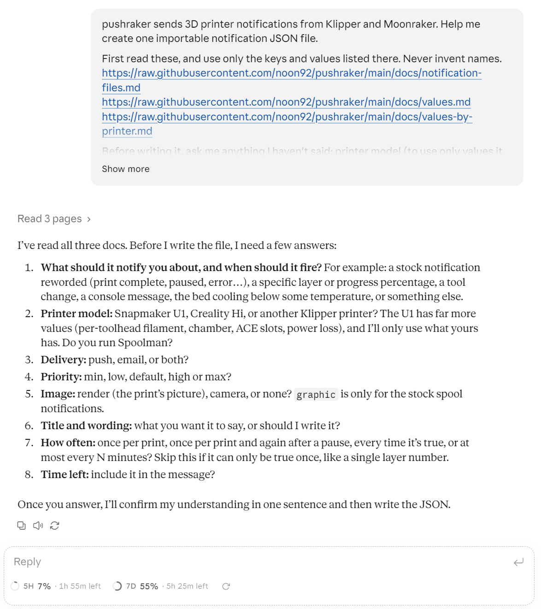

# Notification files

One notification in a JSON file: to give it to someone, keep it, or have
an AI assistant write one from a plain request. On the settings page:
**Export ▴** in a notification's editor (Download, Send by push, Send by
email), and **Import…** under the custom notifications.

- A file holds one notification's own settings: whether it's sent, how
  (push, email, priority), its title and contents (Jinja templates), its
  image and camera, and the settings under its row.
  Export writes every one of them out, so a file means the same if a
  default changes in a later version. In a file written by hand, anything
  left out takes today's default.
- **Never in a file**: tokens, passwords, addresses, server settings,
  and a notification's own topic (ntfy topic or Telegram topic: private to
  you). On import the notification keeps the topic it has here, if any; a
  topic in a file is ignored and named under "Not used".
- Import checks a file like Save does and says what doesn't fit this
  printer. Nothing is saved until **Save & Apply**; **Discard changes**
  undoes it.
- A stock notification in a file **replaces** that notification; a custom
  one replaces the custom notification with the same name, or is added.
  Replacing asks first (the Import button counts down 5 seconds).

## The format

```json
{
  "pushraker_notification": 1,
  "from": {"pushraker": "0.4.0", "printer": "Creality Hi"},
  "kind": "stock",
  "id": "complete",
  "notification": {"enabled": true, "priority": "default", "email": false,
                   "title": "✅ {{ machine.name }}: {{ job.file }} done"}
}
```

| Key | Required | Value |
|---|---|---|
| `pushraker_notification` | yes | `1` |
| `from` | no | `{"pushraker": <version>, "printer": <model>}`: written by Export; used only for the notices. Leave it out when writing a file by hand |
| `kind` | yes | `"stock"` (one of pushraker's notifications) or `"custom"` |
| `id` | stock | which one (table below) |
| `name` | custom | its name: up to 32 letters, digits and `_`, starting with a letter. G-code sends it as `pushraker.<name>` |
| `notification` | yes | its settings (below). Anything left out takes the default. Keys pushraker doesn't know are ignored, and the Import dialog names them |

### A stock notification's settings

| Key | Value | Default |
|---|---|---|
| `enabled` | `true` / `false`: sent by push | per notification |
| `email` | `true` / `false`: sent by email | per notification |
| `priority` | `min`, `low`, `default`, `high`, `max` | per notification |
| `title` | Jinja template, one line, up to 1000 characters | the stock title |
| `contents` | Jinja template, up to 5000 characters | the stock contents |
| `image` | `none`, `render` (the print's picture), `camera`; spool notifications also `graphic` | per notification |
| `camera` | a camera name on the printer; `""`: the default camera. One the printer doesn't have is ignored | `""` |
| `remaining` | `true` / `false`: the spool picture shows what's left (with `graphic`) | `true` |
| *the row's own settings* | see below | |

| `id` | Notification | Its own settings |
|---|---|---|
| `started` | Print started | |
| `preprint_done` | Pre-print calibrations finished | |
| `paused` | Print paused | |
| `resumed` | Print resumed | |
| `layer_started` | First layer started | |
| `first_layer` | Layer complete | `layers_complete`: 1, 2 or 3; `first_layer_objects`: `each` (per object when printing by object) or `once` |
| `progress` | Progress | `progress_marks`: `"25,50,75"` or a part of it |
| `status_report` | Status report | `report_interval`: 5 to 720 minutes of print time |
| `complete` | Print complete | `complete_objects`: `each` or `once` |
| `cancelled` | Print cancelled | |
| `bed_cooled` | Bed cooled | `bed_cool_temp`: 20 to 100 °C |
| `macro` | From macros and G-code | |
| `calibration` | Manual calibrations | |
| `filament_change` | Filament loaded / unloaded | `filament_change_events`: `"loaded,unloaded"`, `"loaded"` or `"unloaded"` |
| `filament_short` | Not enough filament | `filament_unknown`: `true` / `false` (warn about spools at 0 g) |
| `filament_low` | Spool running low | `filament_low_percent`: 0 to 90; `filament_low_grams`: 0 to 5000 |
| `spool_switch` | Switched to backup spool | |
| `slot_empty` | Spool in ACE slot ran out | |
| `chamber_waiting` | Waiting for chamber temperature | |
| `chamber_reached` | Reached chamber temperature | |
| `chamber_fault` | Chamber faults | |
| `error` | Error | |
| `warning` | Warning | |
| `shutdown` | Klipper shutdown | |
| `power_loss` | Power loss recovery | |
| `driver_hot` | Driver running hot | `driver_temp`: 40 to 150 °C |

Which of these a printer can send: [values by printer](values-by-printer.md).

### A custom notification's settings

| Key | Value | Default |
|---|---|---|
| `enabled`, `email`, `priority` | as above | `true`, `false`, `default` |
| `evaluate` | when the condition is checked: `poll` (every 5 seconds), `layer` (each layer change), `tool` (each tool change), `object` (each object, printing by object), `excluded` (an object excluded), `progress` (each 1 %), `console` (each console line) | `poll` |
| `when` | the condition: a Jinja expression, as in `` without the tags, up to 1000 characters. `poll`: sent when it **turns** true. An event: sent each time it's true. Empty: only from G-code (`poll`), or every time (an event) | `""` |
| `title`, `contents` | Jinja templates | `🔔 {{ machine.name }} {{ event.name }}`, `""` |
| `image` | `none`, `render`, `camera` | `camera` |
| `camera` | as above | `""` |
| `repeat` | `change` (each time; at most once a minute, at an event once in 10 s), `job` (once per print job), `job_pause` (once per print job, again after a pause), `minutes` | `change` |
| `repeat_minutes` | 1 to 1440, with `minutes` | `10` |

What each event adds to `event.*`: `layer` → `event.layer`,
`event.previous_layer`; `tool` → `event.toolhead`,
`event.previous_toolhead`; `object` → `event.object`,
`event.previous_object` (each with `name`, `number`, `count`);
`excluded` → `event.object`; `progress` → `event.progress` (0 to 100);
`console` → `event.message`. Every custom notification has `event.name`
and `event.trigger`.

### Templates

Jinja, as in Klipper macros, with these roots: `printer.*` (Klipper's
objects: `printer.heater_bed.temperature`,
`printer["temperature_sensor cavity"].temperature`), `job.*` (the print
job), `extruders.*` (toolheads), `event.*` (this notification),
`machine.*` and `pushraker.*`. Every value: [values](values.md). A value
that isn't there reads `n/a` and is false in ``. Filters of
pushraker's own: `|duration` (`1h 12m`), `|clock` (`09:05`), `|toolhead`
(`Toolhead 2`), `|pct`. A template can set the image or priority for one
notification: ``, ``.
More: the guide's [Templates](guide.md#templates).

## Examples

**1. A stock notification, reworded.** Print complete with the time it
took and the filament used, high priority, by email too:

```json
{"pushraker_notification": 1, "kind": "stock", "id": "complete",
 "notification": {
   "enabled": true, "email": true, "priority": "high",
   "title": "✅ {{ machine.name }}: {{ job.file }} done",
   "contents": "In {{ job.time.elapsed|duration }}, {{ job.filaments.total_grams|round|int }} g.",
   "image": "camera"}}
```

**2. Progress at 50 % only**, quietly:

```json
{"pushraker_notification": 1, "kind": "stock", "id": "progress",
 "notification": {"enabled": true, "priority": "low",
                  "progress_marks": "50"}}
```

**3. A condition checked every 5 seconds**: the bed is cool enough
after a print.

```json
{"pushraker_notification": 1, "kind": "custom", "name": "bed_cool",
 "notification": {
   "evaluate": "poll",
   "when": "printer.heater_bed.temperature < 40 and not printer.heater_bed.target",
   "title": "🛏️ {{ machine.name }}: bed at {{ printer.heater_bed.temperature|round|int }} °C",
   "repeat": "job"}}
```

**4. Every 5th layer**, with a picture:

```json
{"pushraker_notification": 1, "kind": "custom", "name": "every_5th_layer",
 "notification": {
   "evaluate": "layer",
   "when": "job.layer % 5 == 0",
   "title": "🔍 {{ machine.name }}: layer {{ job.layer }} of {{ job.layers }}",
   "contents": "{{ job.progress|round|int }} %, {{ job.time.remaining|duration }} left",
   "image": "camera", "priority": "low"}}
```

**5. A tool change** to a TPU toolhead:

```json
{"pushraker_notification": 1, "kind": "custom", "name": "tpu_now",
 "notification": {
   "evaluate": "tool",
   "when": "extruders.current.filament.material == \"TPU\"",
   "title": "🔧 {{ machine.name }}: now on {{ event.toolhead|toolhead }} (TPU)"}}
```

**6. A console message**, e.g. a probe warning:

```json
{"pushraker_notification": 1, "kind": "custom", "name": "probe_warning",
 "notification": {
   "evaluate": "console",
   "when": "\"Probe\" in event.message",
   "title": "⚠️ {{ machine.name }}: {{ event.message }}",
   "priority": "high", "repeat": "minutes", "repeat_minutes": 30}}
```

**7. Several conditions, once per print**: on Wednesdays, at layer 35, if
the print uses PLA, with the render instead of a photo. `weekday_number` is
1 (Monday) to 7, in the time zone set on the page; `job.filaments.materials`
lists the materials the print really uses, from the file on any printer;
`repeat: job` sends it once per print job.

```json
{"pushraker_notification": 1, "kind": "custom", "name": "wednesday_layer_35",
 "notification": {
   "evaluate": "layer",
   "when": "event.time.weekday_number == 3 and event.layer == 35 and \"PLA\" in job.filaments.materials",
   "title": "🧵 {{ machine.name }}: layer 35 of {{ job.file }}",
   "contents": "{{ job.time.remaining|duration }} left",
   "image": "render", "repeat": "job"}}
```

## Writing one with an AI assistant

<p align="center">
<br>
<em>An AI assistant writing a notification file from the prompt below.</em>
</p>

Paste this into any AI assistant. It asks what you want next:

```text
pushraker sends 3D printer notifications from Klipper and Moonraker. Help me create one importable notification JSON file.

First read these, and use only the keys and values listed there. Never invent names.
https://raw.githubusercontent.com/noon92/pushraker/main/docs/notification-files.md
https://raw.githubusercontent.com/noon92/pushraker/main/docs/values.md
https://raw.githubusercontent.com/noon92/pushraker/main/docs/values-by-printer.md

Before writing it, ask me anything I haven't said: printer model (to use only values it has); push, email or both; priority; image (render, camera, graphic or none); title and wording; when it fires; how often (once per print or every time), unless it can only be true once, like one layer number; whether to show time left. Then confirm your understanding in one sentence.

Give the result as a downloadable .json file if you can make files, otherwise as exactly one JSON code block. Omit "from" and any topic. Then explain in two lines how to import it (Import... on the settings page) and what each condition does.
```

Rules for the assistant:

- Write exactly one JSON object in the format above. `pushraker_notification`
  is `1`. Leave out `from`.
- Use only the `id`s, keys and values listed here, and only values listed
  in [values](values.md) or Klipper's own `printer.<object>.<field>`.
  Don't invent values: ask, or use what the printer surely has.
- Leave out what should stay the default. Never add addresses, tokens,
  topics or server settings.
- `when` is an expression without ``; strings in it use double
  quotes escaped for JSON (`\"TPU\"`). Titles are one line.
- Prefer an event (`layer`, `tool`, `progress`…) over `poll` when the
  request is about something that happens at a moment.
- The person imports it with **Import…** and checks the notices the
  dialog shows (e.g. "Uses values this printer doesn't have").
